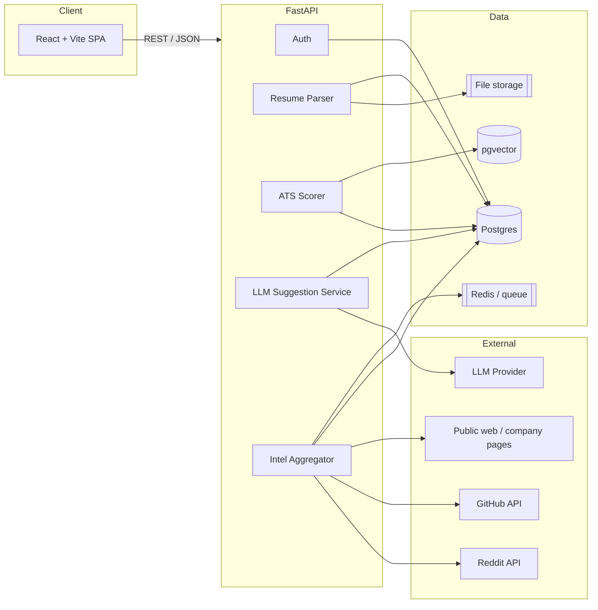

# ResumeRadar

**AI resume reviewer & ATS intelligence — tailored to the role and company you're actually targeting.**

ResumeRadar parses your resume, compares it against a real job description, simulates how an
Applicant Tracking System (ATS) would read it, and produces a prioritized list of gaps plus
concrete, inline suggestions. It also surfaces contextual intel — interview themes, company/role
signals, and the people who matter for that role — so your resume is tuned for a specific target,
not a generic template.

> **Honest positioning:** ResumeRadar is an *ATS simulator*, not an actual ATS. ATS vendors do not
> expose scoring APIs. Our score is a transparent, rule-based heuristic layered on top of an LLM
> review. We tell users exactly why a suggestion was made.

---

## Table of contents

- [Why](#why)
- [What it does](#what-it-does)
- [MVP scope](#mvp-scope)
- [Architecture](#architecture)
- [Tech stack](#tech-stack)
- [Data model](#data-model)
- [Repository layout](#repository-layout)
- [Getting started](#getting-started)
- [Roadmap](#roadmap)
- [Development workflow](#development-workflow)
- [Privacy, ethics & legal](#privacy-ethics--legal)

---

## Why

Most resume tools give generic advice. Applicants rarely know:

- what the specific job description actually optimizes for,
- how a machine parser will shred their formatting,
- what this company/role tends to interview on,
- who the hiring decision-makers are,
- how they compare to engineers who already hold that role.

ResumeRadar closes that gap by tying every suggestion to a **target role + company + job
description**, and by caching intel per company/role so repeat visits are instant and consistent.

---

## What it does

1. **Parse** an uploaded resume (PDF/DOCX) into structured sections.
2. **Target** a role by pasting a job description (or URL).
3. **Score** the resume against the JD using ATS-style rules (parsing, keywords, structure, formatting).
4. **Suggest** prioritized, evidence-backed improvements.
5. **Rewrite inline** with an LLM — diff view, accept/reject per suggestion, versioned history.
6. **Enrich** with public/qualitative intel: Reddit interview themes, public company/role signals,
   and (manually verified or public-source) hiring contacts and comparable engineer profiles.

Each step is explainable. Nothing is a black box.

---

## MVP scope

The MVP deliberately focuses on the first four steps plus a usable editor.

**In scope**

- [ ] User accounts (email + password, JWT).
- [ ] Resume upload: PDF/DOCX → text extraction → section detection.
- [ ] Job description input (paste text; URL import later).
- [ ] ATS simulation: parseability, keyword coverage, section presence, formatting warnings.
- [ ] Gap list: missing keywords/sections/quantification, ranked by impact.
- [ ] LLM suggestions + inline rewrite with diff and per-suggestion accept/reject.
- [ ] Resume version history (every save is a version; diffable).
- [ ] Company/role intel cache: Reddit interview themes + public sources, stored per company/role.
- [ ] Retrieval on return visit: same user, company, role → prior analyses loaded.
- [ ] Themed React UI (dark/light), pixel-polished, responsive.
- [ ] Export back to DOCX (PDF later).

**Out of scope (v1)**

- LinkedIn scraping (against ToS — see [legal](#privacy-ethics--legal)).
- Live ATS verdicts from vendors.
- Paid plans / billing.
- Mobile native apps.

---

## Architecture



**Key design decisions**

- **Everything is scoped to `(user, company, role, job)`** so results are retrievable and reusable.
- **Intel is cached, not re-scraped.** Sources are stored with timestamps and provenance.
- **LLM provider is abstracted** behind an interface; users may bring their own key.
- **Scoring is deterministic and rule-based**, then LLM adds *explanation and rewriting* — not the score
  itself, so results are reproducible and testable.
- **Parser and scorer are pure, testable modules** with no network dependencies.

---

## Tech stack

| Layer | Choice | Notes |
|-------|--------|-------|
| Frontend | React + Vite + TypeScript | Themed (dark/light), accessible components |
| Styling | Tailwind CSS + shadcn/ui | Pixel-precise, consistent design system |
| Editor | TipTap | Inline editing + diff view |
| Backend | FastAPI + Python 3.12 | Async, typed, OpenAPI docs |
| ORM | SQLAlchemy 2 + Alembic | Migrations from day one |
| DB | PostgreSQL + pgvector | Embeddings and similarity search |
| Queue | Redis + RQ/Celery | Slow fetch/LLM jobs off the request path |
| Auth | JWT (access tokens) | Hashing via passlib/argon2 |
| Testing | pytest / vitest | Unit + integration |
| Infra | Docker Compose | One-command local stack |
| CI | GitHub Actions | Lint, typecheck, tests |

---

## Data model

```text
users
  id, email, password_hash, created_at

companies
  id, name, slug, domain, created_at

roles
  id, title, level, created_at            # e.g. "Backend Engineer", "Senior"

jobs
  id, company_id, role_id, user_id,
  title, description_text, source_url, created_at

resumes
  id, user_id, filename, created_at

resume_versions
  id, resume_id, version_no, raw_text,
  sections_json, created_at, parent_version_id

analyses
  id, user_id, resume_version_id, job_id,
  ats_score, score_breakdown_json, created_at

suggestions
  id, analysis_id, category, severity,
  message, evidence, proposed_text, accepted_at

insights
  id, company_id, role_id, kind,          # interview | profile | contact | signal
  title, summary, source_url, source_kind,
  fetched_at, confidence

embeddings
  id, owner_type, owner_id, vector        # pgvector
```

Every suggestion points back to `evidence`, and every insight records `source_url`, `source_kind`,
and `fetched_at`. Provenance is a first-class feature.

---

## Repository layout

```text
resume-radar/
├── backend/
│   ├── app/
│   │   ├── api/            # routers (auth, resumes, jobs, analyses, intel)
│   │   ├── core/           # config, security, db session
│   │   ├── models/         # SQLAlchemy models
│   │   ├── schemas/        # Pydantic schemas
│   │   ├── services/       # parser, scorer, llm, intel
│   │   └── main.py
│   ├── tests/
│   ├── alembic/
│   └── pyproject.toml
├── frontend/
│   ├── src/
│   │   ├── components/
│   │   ├── pages/
│   │   ├── features/       # upload, analysis, editor, intel
│   │   ├── lib/
│   │   └── styles/
│   ├── index.html
│   └── package.json
├── docs/
├── docker-compose.yml
├── .env.example
└── README.md
```

---

## Getting started

> Scaffolding lands incrementally. This section will be filled in as services come online.

```bash
# clone
git clone <repo-url> resume-radar && cd resume-radar

# environment
cp .env.example .env      # fill in keys

# backend
python -m venv .venv && .venv\Scripts\activate
pip install -e backend
uvicorn app.main:app --reload --app-dir backend

# frontend
cd frontend && npm install && npm run dev
```

---

## Roadmap

| Phase | Deliverable |
|-------|-------------|
| 0 | Repo, CI, docs, Docker skeleton |
| 1 | Auth + resume upload + parsing |
| 2 | Job targeting + ATS simulation + gap list |
| 3 | LLM suggestions + inline editor + version history |
| 4 | Company/role intel aggregation + cache |
| 5 | Export (DOCX), retrieval on return, polish |

---

## Development workflow

**Trunk-based with short-lived feature branches.**

- `main` is always deployable.
- One branch per feature: `feat/…`, `fix/…`, `chore/…`, `docs/…`, `test/…`.
- Small commits, one logical change each, Conventional Commits style.
- Open a PR → **squash merge** → delete branch → pull `main` → next branch.
- No long-lived `develop` branch.

```
main
├── chore/scaffold
├── feat/backend-models
├── feat/resume-parser
├── feat/ats-scorer
├── feat/llm-suggestions
├── feat/company-intel
├── feat/frontend-shell
└── feat/frontend-editor
```

Commit message format:

```
<type>(<scope>): <short summary>

<body: what and why>
```

Types: `feat`, `fix`, `chore`, `docs`, `test`, `refactor`, `perf`, `ci`.

---

## Privacy, ethics & legal

- **No LinkedIn scraping.** It violates LinkedIn's Terms of Service. Hiring-contact info comes from
  public company pages, press releases, or user-provided data only.
- **Reddit via official API** (OAuth, rate limits, attribution). Reddit content is qualitative
  context, not ground truth.
- **No storing other people's personal data** beyond what is public and necessary; provide
  deletion on request.
- **User resumes and keys are private.** BYO-key values are used per-request and never logged.
- **Scores are heuristics.** The product must state this clearly wherever a score is shown.

---

## License

TBD.
