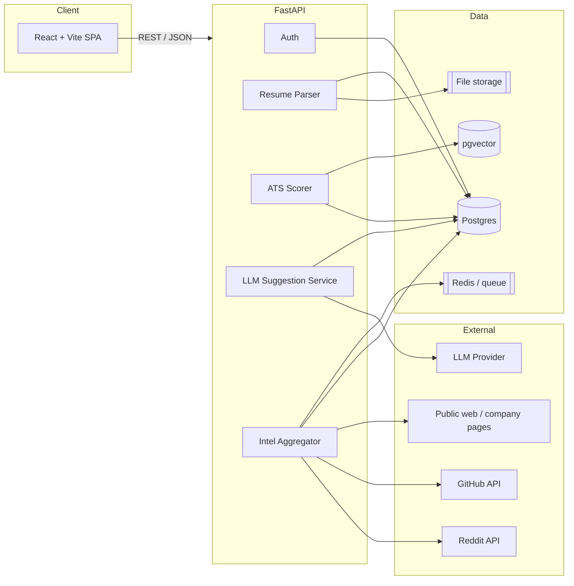

# ResumeRadar

**AI resume reviewer & ATS intelligence — tailored to the role and company you're actually targeting.**

ResumeRadar parses your resume, compares it against a real job description, simulates how an
Applicant Tracking System (ATS) would read it, and produces a prioritized list of gaps plus
concrete, inline suggestions. It also surfaces contextual intel — interview themes, company/role
signals, and the people who matter for that role — so your resume is tuned for a specific target,
not a generic template.

> **Honest positioning:** ResumeRadar is an *ATS simulator*, not an actual ATS. ATS vendors do not
> expose scoring APIs. Our score is a transparent, rule-based heuristic layered on top of an LLM
> review. We tell users exactly why a suggestion was made.

---

## Table of contents

- [Why](#why)
- [What it does](#what-it-does)
- [MVP scope](#mvp-scope)
- [Architecture](#architecture)
- [Tech stack](#tech-stack)
- [Data model](#data-model)
- [Repository layout](#repository-layout)
- [Getting started](#getting-started)
- [API](#api)
- [Roadmap](#roadmap)
- [Development workflow](#development-workflow)
- [Privacy, ethics & legal](#privacy-ethics--legal)

---

## Why

Most resume tools give generic advice. Applicants rarely know:

- what the specific job description actually optimizes for,
- how a machine parser will shred their formatting,
- what this company/role tends to interview on,
- who the hiring decision-makers are,
- how they compare to engineers who already hold that role.

ResumeRadar closes that gap by tying every suggestion to a **target role + company + job
description**, and by caching intel per company/role so repeat visits are instant and consistent.

---

## What it does

1. **Parse** an uploaded resume (PDF/DOCX) into structured sections.
2. **Target** a role by pasting a job description (or URL).
3. **Score** the resume against the JD using ATS-style rules (parsing, keywords, structure, formatting).
4. **Suggest** prioritized, evidence-backed improvements.
5. **Rewrite inline** in the editor and re-score; every save becomes a new resume version.
6. **Enrich** with public/qualitative intel: Reddit interview themes and public company/role
   signals, cached per company and role.

Each step is explainable. Nothing is a black box.

---

## MVP scope

The MVP deliberately focuses on the first four steps plus a usable editor.

**In scope**

- [x] User accounts (email + password, JWT).
- [x] Resume upload: PDF/DOCX → text extraction → section detection.
- [x] Job description input (paste text; URL import later).
- [x] ATS simulation: parseability, keyword coverage, section presence, formatting warnings.
- [x] Gap list: missing keywords/sections/quantification, ranked by impact.
- [x] LLM suggestions (rule-based fallback) plus an inline editor that re-scores and saves a version.
- [ ] Diff view with per-suggestion accept/reject.
- [x] Resume version history (every save is a version; diffable).
- [x] Company/role intel cache: Reddit interview themes + public sources, stored per company/role.
- [x] Retrieval on return visit: same user, company, role → prior analyses loaded.
- [x] Themed React UI (dark/light), pixel-polished, responsive.
- [x] Export back to DOCX (PDF later).

**Out of scope (v1)**

- LinkedIn scraping (against ToS — see [legal](#privacy-ethics--legal)).
- Live ATS verdicts from vendors.
- Paid plans / billing.
- Mobile native apps.

---

## Architecture



**Key design decisions**

- **Everything is scoped to `(user, company, role, job)`** so results are retrievable and reusable.
- **Intel is cached, not re-scraped.** Sources are stored with timestamps and provenance.
- **LLM provider is abstracted** behind an interface; users may bring their own key.
- **Scoring is deterministic and rule-based**, then LLM adds *explanation and rewriting* — not the score
  itself, so results are reproducible and testable.
- **Parser and scorer are pure, testable modules** with no network dependencies.

---

## Tech stack

| Layer | Choice | Notes |
|-------|--------|-------|
| Frontend | React 19 + Vite + TypeScript | Themed (dark/light), responsive |
| Routing | React Router | Client-side routes for auth, workspace and analysis |
| Styling | Tailwind CSS v4 | Semantic design tokens, dark variant |
| Backend | FastAPI + Python 3.12 | Async, typed, OpenAPI docs |
| ORM | SQLAlchemy 2 + Alembic | Migrations from day one |
| DB | PostgreSQL (pgvector image) / SQLite | Postgres in Docker, SQLite for quick local runs |
| Queue | Redis | Reserved for slow fetch/LLM jobs |
| Auth | JWT (access tokens) | PBKDF2 hashing via `hashlib` |
| Parsing | pypdf + python-docx | Pure, testable extraction pipeline |
| Export | python-docx | Heading/bullet-aware DOCX rendering |
| Testing | pytest + TestClient | Unit and API integration tests |
| Linting | ruff + oxlint | Backend and frontend static checks |
| Infra | Docker Compose | Postgres, Redis, API and nginx-served SPA |
| CI | GitHub Actions | Lint, tests and production build |

---

## Data model

```text
users
  id, email, password_hash, created_at

companies
  id, name, slug, domain, created_at

roles
  id, title, level, created_at            # e.g. "Backend Engineer", "Senior"

jobs
  id, company_id, role_id, user_id,
  title, description_text, source_url, created_at

resumes
  id, user_id, filename, created_at

resume_versions
  id, resume_id, version_no, raw_text,
  sections_json, created_at, parent_version_id

analyses
  id, user_id, resume_version_id, job_id,
  ats_score, score_breakdown_json, created_at

suggestions
  id, analysis_id, category, severity,
  message, evidence, proposed_text, accepted_at

insights
  id, company_id, role_id, kind,          # interview | profile | contact | signal
  title, summary, source_url, source_kind,
  fetched_at, confidence

embeddings
  id, owner_type, owner_id, vector        # pgvector
```

Every suggestion points back to `evidence`, and every insight records `source_url`, `source_kind`,
and `fetched_at`. Provenance is a first-class feature.

---

## Repository layout

```text
resume-radar/
├── backend/
│   ├── app/
│   │   ├── api/            # routers (auth, analyses, intel) + deps
│   │   ├── core/           # config, security, db session, slugs
│   │   ├── models/         # SQLAlchemy models
│   │   ├── schemas/        # Pydantic schemas
│   │   ├── services/       # parsing, scoring, llm, intel, export
│   │   └── main.py
│   ├── alembic/            # migration environment + versions
│   ├── tests/
│   ├── Dockerfile
│   └── pyproject.toml
├── frontend/
│   ├── src/
│   │   ├── components/     # shell, auth, score, suggestions, intel, editor
│   │   ├── lib/            # API client, theme and auth contexts
│   │   ├── pages/          # landing, auth, workspace, analysis
│   │   ├── App.tsx
│   │   └── index.css
│   ├── Dockerfile
│   ├── nginx.conf
│   └── package.json
├── .github/workflows/ci.yml
├── docker-compose.yml
├── .env.example
└── README.md
```

---

## Getting started

**Prerequisites:** Python 3.12+, Node 22+ (Docker optional).

```bash
# clone
git clone https://github.com/binaryxankit/resume-radar.git
cd resume-radar

# environment
cp .env.example .env      # fill in keys (LLM and Reddit are optional)

# backend
python -m venv backend/.venv
backend/.venv/Scripts/activate          # Windows
# source backend/.venv/bin/activate     # macOS / Linux
pip install -e "backend[dev]"

cd backend
alembic upgrade head
uvicorn app.main:app --reload
```

The API runs at <http://127.0.0.1:8000> with OpenAPI docs at `/docs`.

```bash
# frontend (new terminal)
cd frontend
npm install
npm run dev
```

The app runs at <http://localhost:5173>. Vite proxies `/api` to the backend, so no CORS
configuration is needed in development.

**Verify the backend**

```bash
cd backend
ruff check app tests
pytest -q
```

**Docker Compose (full stack)**

```bash
docker compose up --build
```

This starts Postgres (pgvector), Redis, the API (migrations run on boot) and the SPA behind
nginx at <http://localhost:5173>.

**Optional integrations**

- `OPENAI_API_KEY` (or a per-request `X-LLM-API-Key` header from the UI) enables LLM rewrites.
  Without a key, suggestions fall back to deterministic rules.
- `REDDIT_CLIENT_ID` / `REDDIT_CLIENT_SECRET` enable company intel. Without them the intel panel
  reports that the source is unavailable.

---

## API

All analysis and intel routes require `Authorization: Bearer <token>`.

| Method | Path | Purpose |
|--------|------|---------|
| `GET` | `/health` | Liveness probe |
| `POST` | `/api/auth/register` | Create an account |
| `POST` | `/api/auth/login` | Exchange credentials for a JWT |
| `GET` | `/api/auth/me` | Current user profile |
| `POST` | `/api/analyses` | Upload resume + job description (multipart) |
| `GET` | `/api/analyses` | Paginated history (`q`, `limit`, `offset`) |
| `GET` | `/api/analyses/{id}` | Full analysis with score, sections and suggestions |
| `POST` | `/api/analyses/{id}/reanalyze` | Re-score edited resume text, saving a new version |
| `GET` | `/api/analyses/{id}/export` | Download the resume version as DOCX |
| `GET` | `/api/intel` | Cached company/role intel (`company`, `role`, `refresh`) |

`POST /api/analyses` accepts `file`, `job_description`, `company_name`, `role_title`, optional
`role_level` / `source_url`, and an optional `X-LLM-API-Key` header.

`GET /api/analyses` returns `{ items, total, limit, offset }`. `q` matches company, role or job
title case-insensitively, `limit` is 1–100 (default 20) and `offset` defaults to 0. The workspace
search is debounced and stored in the URL (`/app?q=…`), so reloads and shared links keep it.

---

## Roadmap

| Phase | Deliverable | Status |
|-------|-------------|--------|
| 0 | Repo, CI, docs, Docker skeleton | Done |
| 1 | Auth + resume upload + parsing | Done |
| 2 | Job targeting + ATS simulation + gap list | Done |
| 3 | LLM suggestions + inline editor + version history | Done (diff view pending) |
| 4 | Company/role intel aggregation + cache | Done |
| 5 | DOCX export, retrieval on return, polish | Done |

---

## Development workflow

**Trunk-based with short-lived feature branches.**

- `main` is always deployable.
- One branch per feature: `feat/…`, `fix/…`, `chore/…`, `docs/…`, `test/…`.
- Small commits, one logical change each, Conventional Commits style.
- Open a PR → **rebase merge** → delete branch → pull `main` → next branch.
- No long-lived `develop` branch.

```
main
├── feat/backend-models
├── feat/resume-parser
├── feat/ats-scorer
├── feat/llm-suggestions
├── feat/company-intel
├── feat/frontend-shell
├── feat/frontend-app
└── feat/export
```

Commit message format:

```
<type>(<scope>): <short summary>

<body: what and why>
```

Types: `feat`, `fix`, `chore`, `docs`, `test`, `refactor`, `perf`, `ci`.

---

## Privacy, ethics & legal

- **No LinkedIn scraping.** It violates LinkedIn's Terms of Service. Hiring-contact info comes from
  public company pages, press releases, or user-provided data only.
- **Reddit via official API** (OAuth, rate limits, attribution). Reddit content is qualitative
  context, not ground truth.
- **No storing other people's personal data** beyond what is public and necessary; provide
  deletion on request.
- **User resumes and keys are private.** BYO-key values are used per-request and never logged.
- **Scores are heuristics.** The product must state this clearly wherever a score is shown.

---

## License

TBD.
